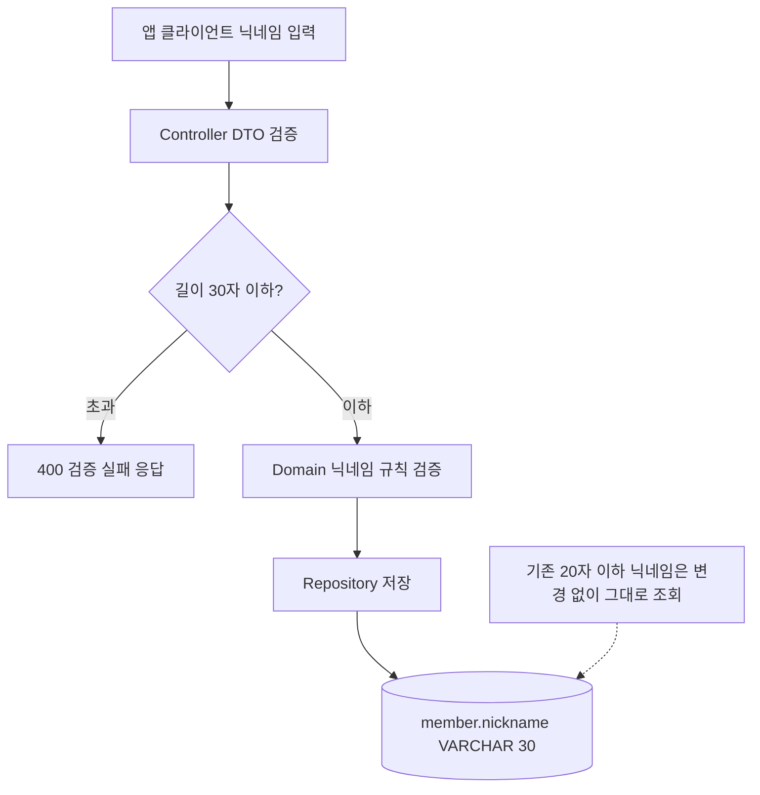

# 회원 닉네임 최대 길이 확장 TDD (Technical Design Document)

닉네임 최대 길이 20자 → 30자 확장 TDD 설계 완료 (코드 변경 없음, 리뷰 전)
- 변경 범위: `pasta-api` 닉네임 검증 상수·DTO, DB 컬럼 길이 확인 후 필요 시 Flyway 1건, Phase 3개
- 핵심 결정: 기존 닉네임은 데이터 변환 없이 유지, 길이 상한만 변경
- 미결 3건: 서버 담당자 확인 필요 (7절), 저장소 현황은 접근 불가라 미확인

## 문서 상단 칸

### 리뷰 요청 사항
- `member` 닉네임 컬럼의 실제 타입·길이 확인 요청 (1절 가정 A-1, 3절 분기에 영향)
- 길이 계산 기준(문자 수 vs UTF-16 단위) 합의 요청 (5절)

### 리스크
- 앱 클라이언트(iOS/Android)가 20자 입력 제한을 따로 두고 있으면 서버만 바꿔도 가입 이탈이 줄지 않는다. 미확인
- 닉네임을 노출하는 다른 화면·외부 연동(푸시, 리더보드 등)의 표시 폭 초과. 미확인

### 외부 의존성
- 앱 클라이언트 입력 제한 변경 배포 (서버와 배포 순서 조율 필요)
- 닉네임 값을 복제·저장하는 다른 테이블·모듈의 컬럼 길이. 미확인

## 1. 개요

- 연관 PRD: 사용자 제공 PRD 요약 "회원 닉네임 최대 길이 확장" (파일 경로 미제공, 요약 텍스트를 소스로 사용)
- 요청 유형 판단: "TDD 작성해줘" 키워드 → 풀패키지, Q&A 없이 일괄 산출. 턴별 분할을 원하면 말해 달라
- 복잡도 판단: 필드 제약 변경이라 경량(4섹션)에 해당한다. 사용자가 9섹션 전부를 요청해 표준 구조로 작성했고, 3~6절은 짧게 쓴다
- 배경: 일본어 닉네임이 20자 제한에 걸려 가입 이탈 문의 월 30건

| ID | 요구사항 | 기술 해석 |
|----|----------|-----------|
| FR-1 | 최대 길이 20자 → 30자 | 서버 검증 상한 30으로 변경, DB 컬럼이 30 미만이면 확장 |
| FR-2 | 기존 닉네임 유지 | 데이터 갱신 쿼리 없음, 컬럼 확장만 수행 |
| NFR-1 | 프로필 조회 응답 시간 변화 없음 | 조회 쿼리·인덱스·응답 구조 불변 |

- 변경 범위: 모듈 `pasta-api`, 레이어 Web(DTO 검증) / Domain(닉네임 규칙) / DB 마이그레이션

### 컨텍스트 (Phase 0.5 결과)

현황 파악은 저장소 접근 불가로 수행하지 못했다. 아래 확인 명령을 구현 착수 전에 실행해 출력을 받아야 한다.

#### 확인됨
- PRD 요약의 FR-1, FR-2, NFR-1 세 건 (사용자 제공 텍스트)
- 프로젝트 구성: `pasta-api` 멀티모듈, Spring Boot/Java, JPA, Flyway, MySQL (사용자 제공 맥락)

#### 가정 (재평가 트리거 포함)
| # | 가정 | 재평가 트리거 |
|---|------|--------------|
| A-1 | 테이블 `member`, 컬럼 `nickname`이 `VARCHAR(20)` | `grep -rn "nickname" api/src/main/resources/db/migration/` 결과가 다르면 3절 분기 변경 |
| A-2 | 20자 제한이 서버 코드(DTO 검증 어노테이션 또는 도메인 상수) 한 곳 이상에 있다 | `grep -rniE "nickname.*(20|Size|Length)" api/src/main/java/` 결과로 수정 대상 확정 |
| A-3 | 닉네임 컬럼은 `utf8mb4`로 저장 (일본어·이모지 저장 가능) | `SHOW FULL COLUMNS FROM member` 의 Collation 이 다르면 3절에 문자셋 변경 추가 |
| A-4 | 닉네임 컬럼에 별도 인덱스가 없거나 유니크 인덱스가 걸려 있어도 길이 30은 허용 범위 | `SHOW INDEX FROM member` 확인 |
| A-5 | 이 기능에 신규 엔드포인트가 필요 없다 | Apidog 명세에서 닉네임 필드가 있는 API 목록 확인 |

#### 확인 명령 (사용자 실행 요청)
- 기존 도메인: `grep -rniE "nickname" api/src/main/java/ | head -50`
- Base class: `find . -name "Base*.java" -not -path "*/test/*"`
- 마이그레이션 현황: `ls api/src/main/resources/db/migration/ | tail -5`
- SecurityConstants: 신규 경로가 없어 조회 불필요

## 2. 시스템 아키텍처

- 위치: 회원 가입·프로필 수정 흐름의 입력 검증과 저장 컬럼. 프로필 조회 경로는 수정하지 않는다
- 레이어 흐름: Web(DTO 검증) → Application → Domain(규칙) → Infrastructure(JPA)
- Note: 검증 상한이 DTO와 Domain 두 곳에 흩어져 있으면 하나의 상수로 모은다 (Phase 1)

## 3. 데이터베이스 설계

분기는 가정 A-1 의 확인 결과로 정한다.

| 분기 | 조건 | 조치 |
|------|------|------|
| 분기 1 | 컬럼이 `VARCHAR(20)` | Flyway 1건으로 `VARCHAR(30)` 확장 |
| 분기 2 | 컬럼이 이미 30 이상 | 마이그레이션 없음, 서버 검증만 변경 |

- 분기 1 마이그레이션 파일: `api/src/main/resources/db/migration/V202611131000__alter_member_nickname_length.sql` (버전 번호는 `ls ... | tail -5` 확인 후 최신보다 큰 값으로 확정)
- 분기 1 SQL 초안: `ALTER TABLE member MODIFY COLUMN nickname VARCHAR(30) NOT NULL;` — 현재 컬럼의 NULL 허용·기본값·COMMENT·Collation 을 `SHOW CREATE TABLE member` 로 확인해 그대로 옮긴다. 누락하면 제약이 바뀐다
- 신규 테이블·인덱스: 만들지 않는다. 기존 마이그레이션 파일은 수정·삭제하지 않는다
- 체크리스트: 마이그레이션 실행 대상 DB 이름 확인 (로컬·jp-dev·stg·prd 각각)
- FR-2 근거: `MODIFY` 는 길이만 늘리며 행 값을 갱신하지 않는다. 데이터 변환 쿼리를 쓰지 않는다
- NFR-1 근거(가정): MySQL InnoDB 에서 VARCHAR 길이 확장은 길이 바이트 수가 같으면 테이블 재구성 없이 처리되는 것으로 알려져 있다. 실행 방식은 dev 에서 `ALGORITHM=INPLACE, LOCK=NONE` 을 명시해 시험하고, 지원되지 않으면 오류로 알려 준다. 재평가 트리거: 오류가 나면 운영 작업 시간대 협의

## 4. API 명세

신규·변경 엔드포인트가 없다. 확인한 사실: PRD 요약(FR-1, FR-2, NFR-1)이 요구하는 것은 입력 허용 길이 변경뿐이다.

- 영향받는 기존 API(가정 A-5, 경로는 Apidog 확인 필요): 회원 가입, 프로필 수정 (요청 `nickname` 필드 최대 길이 20 → 30)
- 프로필 조회 응답: 필드 구성·타입 불변 (NFR-1)
- 검증 실패 응답: 기존 형식 유지, 메시지에 최대 길이가 하드코딩돼 있으면 30으로 갱신 (i18n 메시지 파일 확인 필요, 한국어·일본어 모두)
- SecurityConstants: 신규 경로가 없어 `SecurityConstants.airArray` 등록 작업 불필요

## 5. 알고리즘 및 비즈니스 로직

복잡한 분기 없음. 길이 계산 기준만 정한다.

- 기준 제안: 사용자가 보는 글자 수가 아니라 `String.codePointCount(0, len)` 기준 코드포인트 수로 30자를 판정한다. 이유: 일본어 한자 일부(예: 𠮷)와 이모지는 UTF-16 에서 2단위라 `String.length()` 기준이면 29자만 입력해도 거부될 수 있다
- 대안: 기존 코드가 `String.length()` 를 쓰고 있으면 동작을 바꾸지 않고 상한만 30으로 둔다 (회귀 최소화). 선택은 리뷰 요청 사항 2번
- MySQL `VARCHAR(30)` 은 utf8mb4 에서 문자(코드포인트) 30개를 저장하므로 코드포인트 기준과 일치한다 (A-3 전제)
- 검증 순서: null/공백 체크 → 길이 → 금칙어·중복 등 기존 규칙 순으로 비용 낮은 것부터. 기존 순서는 유지한다
- 도메인 개선 제안: 길이 상수 `MAX_LENGTH` 를 Domain 한 곳에 두고 DTO 가 참조하게 한다 (Rich Domain, 중복 상수 제거)

## 6. 인터페이스 정의

외부 시스템 신규 연동이 없다. 확인한 사실: 변경은 입력 검증과 컬럼 길이뿐이고 Client/ClientService 를 추가하지 않는다.

- 환경변수 4곳(`.env`, `application.yml`, `application-jp-*.yml`, Secret Manager) 설정 불필요
- 영향 받는 소비자(미확인): 닉네임을 읽어 가는 앱 화면, 푸시 문구, 타 모듈 복제 컬럼. 목록은 `grep -rniE "nickname" api/src/main/java/` 로 확정한다

## 7. 아키텍처 적합성 분석

- 모듈: `pasta-api` 단일 모듈, 기존 member 도메인 위치 (가정 A-2, 확인 필요)
- 패턴: 4-Tier·Repository 3단계 패턴을 그대로 따르며 신규 클래스를 만들지 않는다
- 보안: 입력 검증 완화(상한 증가)이므로 권한 체크 변경 없음. 길이 상한이 늘어도 SQL 은 JPA 파라미터 바인딩 사용
- Base class: 신규 예외·응답 클래스를 만들지 않아 `BaseRuntimeException` 등 재발명 우려 없음

### 우려 지점과 대안
| # | 우려 | 쉬운 설명 | 대안 |
|---|------|-----------|------|
| C-1 | 앱 클라이언트 제한 | 앱이 20자에서 막으면 서버를 바꿔도 효과가 없다 | 앱 팀에 변경 요청, 서버 배포를 먼저 하고 앱 배포를 뒤에 한다 |
| C-2 | 길이 계산 기준 불일치 | 앱·서버가 서로 다르게 세면 앱은 통과, 서버는 거부가 생긴다 | 코드포인트 기준으로 통일 (5절) |
| C-3 | 표시 폭 초과 | 30자 닉네임이 목록·리더보드에서 잘릴 수 있다 | 화면별 말줄임 처리 여부 디자인 확인 |

## 8. 구현 단계 (Phases)

### 사전 준비
1. 작업 브랜치 생성 (`api/feat/extend-member-nickname-length`, base `dev`)
2. 1절 확인 명령 출력으로 가정 A-1~A-5 확정

### Phase 실행 (에이전트 1회 호출로 전체 구현)
1. Phase 1~3 코드를 한번에 구현
2. 전체 구현 완료 후 테스트 실행 (`./gradlew :pasta-api:test`)
3. 테스트 실패 시 자체 수정·재실행 (5회 미만). 5회 이상 실패 시 중단, 보고
4. 테스트 통과 후 반환

### 커밋·체크 (메인 컨텍스트)
1. Phase별 관련 파일을 나눠 개별 커밋
2. 각 커밋 후 `- [ ]` 를 `- [x]` 로 업데이트
3. 전체 완료 후 PR 생성 여부 확인

(아래 파일 경로의 `...` 와 클래스명은 가정 A-2 기준이며, grep 결과로 실제 경로를 확정한다.)

### Phase 1: 닉네임 길이 규칙 단일화 (Domain + Web)
- **목표**: 상한 30을 한 곳에서 정의하고 가입·프로필 수정 DTO 가 참조
- **TODO**:
  - [ ] `api/src/main/java/com/kakaohealthcare/moneyball/api/.../domain/member/Nickname*.java` — `MAX_LENGTH = 30` 상수 (기존 20 상수 교체), 길이 판정 메서드 `isValidLength(String)` (5절 기준)
  - [ ] `api/src/main/java/com/kakaohealthcare/moneyball/api/.../web/member/*SignUpRequest.java` — `@Size(max = ...)` 를 상수 참조로 변경
  - [ ] `api/src/main/java/com/kakaohealthcare/moneyball/api/.../web/member/*ProfileUpdateRequest.java` — 동일 변경
  - [ ] i18n 메시지 파일(`api/src/main/resources/messages*.properties`) — 최대 길이 문구가 20으로 하드코딩돼 있으면 30으로 갱신
- **테스트**: Domain `Nickname*Test` — 경계값 30자 허용, 31자 거부, 20자 허용(FR-2 회귀), 서로게이트 문자 포함 케이스. Web `@WebMvcTest` — 31자 요청 400
- **커밋 계획**:
  - `feat: 닉네임 최대 길이 상수를 30자로 확장`
  - `test: 닉네임 길이 경계값 테스트 추가`
- **커밋 대상 파일 목록**:
  - `api/src/main/java/com/kakaohealthcare/moneyball/api/.../domain/member/Nickname*.java`
  - `api/src/main/java/com/kakaohealthcare/moneyball/api/.../web/member/*SignUpRequest.java`
  - `api/src/main/java/com/kakaohealthcare/moneyball/api/.../web/member/*ProfileUpdateRequest.java`
  - `api/src/main/resources/messages*.properties`
  - `api/src/test/java/com/kakaohealthcare/moneyball/api/.../domain/member/Nickname*Test.java`
  - `api/src/test/java/com/kakaohealthcare/moneyball/api/.../web/member/*Test.java`

### Phase 2: DB 컬럼 확장 (분기 1 해당 시)
- **목표**: `member.nickname` 을 `VARCHAR(30)` 으로 확장, 기존 값 유지
- **TODO**:
  - [ ] `api/src/main/resources/db/migration/V202611131000__alter_member_nickname_length.sql` — `ALTER TABLE ... MODIFY COLUMN` (3절, 현재 컬럼 정의 복사). 분기 2 이면 이 Phase 를 건너뛴다
  - [ ] `api/src/main/java/com/kakaohealthcare/moneyball/api/.../infrastructure/persistence/member/MemberJpaEntity.java` — `@Column(length = 20)` 이 있으면 30으로 변경
  - [ ] 실행 대상 DB 이름 확인 (jp-dev 먼저)
- **테스트**: Infrastructure `MemberRepositoryImplTest` (`@DataJpaTest` + Testcontainers MySQL, H2 사용 안 함) — 30자 닉네임 저장·조회 왕복, Flyway 적용 후 20자 이하 기존 행 유지
- **커밋 계획**:
  - `feat: 회원 닉네임 컬럼 길이 30자로 확장 마이그레이션 추가`
  - `test: 30자 닉네임 저장·조회 통합 테스트 추가`
- **커밋 대상 파일 목록**:
  - `api/src/main/resources/db/migration/V202611131000__alter_member_nickname_length.sql`
  - `api/src/main/java/com/kakaohealthcare/moneyball/api/.../infrastructure/persistence/member/MemberJpaEntity.java`
  - `api/src/test/java/com/kakaohealthcare/moneyball/api/.../infrastructure/persistence/member/MemberRepositoryImplTest.java`

### Phase 3: 영향 범위 점검 및 NFR-1 확인
- **목표**: 닉네임을 쓰는 다른 경로의 길이 가정 제거, 조회 성능 불변 확인
- **TODO**:
  - [ ] `grep -rniE "nickname" api/src/main/java/` 결과 중 20 하드코딩·`substring(0, 20)` 류 제거 (파일 경로는 grep 결과로 TODO 에 추가)
  - [ ] 프로필 조회 서비스 `api/src/main/java/com/kakaohealthcare/moneyball/api/.../application/member/*ProfileService.java` — 변경하지 않음을 확인만 한다
  - [ ] dev 에서 프로필 조회 응답 시간을 변경 전후 비교해 기록 (측정 전에는 "변화 없음" 이라고 쓰지 않는다)
- **테스트**: 기존 프로필 조회 테스트 전체 재실행(회귀). 응답 시간은 수동 측정
- **커밋 계획**:
  - `refac: 닉네임 길이 하드코딩 제거`
- **커밋 대상 파일 목록**: grep 결과로 확정. 변경 대상이 없으면 이 Phase 는 커밋 없이 점검 결과만 PR 본문에 기록한다

## 9. 테스트 전략

| 계층 | 테스트 클래스 | 방식 | 검증 내용 |
|------|-------------|------|-----------|
| Domain | `Nickname*Test` | 순수 JUnit 5 | 20자·30자 허용, 31자 거부, 서로게이트 문자, 공백 |
| Application | 기존 가입·프로필 수정 서비스 테스트 | Mockito | 30자 닉네임 정상 흐름 (기존 테스트 회귀) |
| Infrastructure | `MemberRepositoryImplTest` | `@DataJpaTest` + Testcontainers(MySQL) | 30자 저장·조회, 마이그레이션 후 기존 행 유지 |
| Web | 가입·프로필 수정 컨트롤러 테스트 | `@WebMvcTest` + MockMvc | 30자 200, 31자 400, 오류 메시지 |

- Testcontainers(MySQL) 사용, H2 전환 안 함
- 주요 시나리오: FR-1 (30자 허용), FR-2 (기존 20자 이하 유지), NFR-1 (조회 쿼리 불변, dev 수동 측정)
- 본 문서 작성 시점에 테스트·빌드는 실행하지 않았다 (설계 문서)
